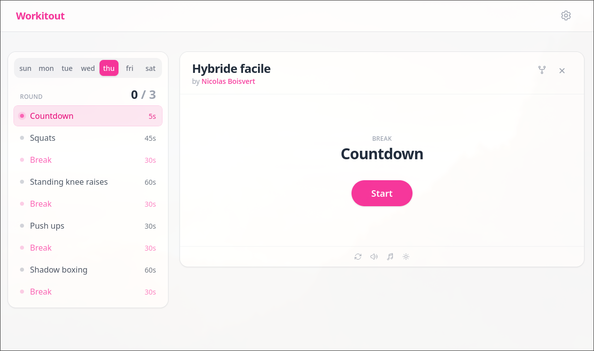

# Workitout

Just a training plan runner, stateless, no flafla, no data gathering. Just you, your plan, maybe some music and your sweat.

[Open the application here](https://work.nbvt.xyz)

## What is Workitout

It's a simple Plan runner. Really. You can simple create a training plan from the UI (using the "Create plan" button), decide what you want to do on which day, hit run, and do it.

### Let's build a community

The application comes with some community provided plans. When you open the app, you can quickly pick one of the community provided plans and just do it.

The is meant to be community driven, so if **you** have a nice plan you like and want to share it. You simply have to export the plan from the interface and open a Pull request to the ̀`plans` branch. (Or just [email me the plan](mailto:nicolas@nboisvert.com) if you're not a nerd like me).

## Why the statelessness and why it matters

Don't you think that the internet knows enough about you? I do. So it was really important to me that this application is just GitHub based and stateless to **your** browser. No account. No signup. Nothing.

When you play around with the application, no data is sent anywhere. It's all local to your browser's local storage and any data we store, wether it's your settings or your custom plans, can be exported easily and stored wherever you want.

This impacte the decision when it came to music, for instance. The most logical choice would've been a Spotify integration you login with your account, but I don't want to manage any of your data. So I went on and used [Audius](https://audius.co/trending?timeRange=week), a pretty sick, simple and free to use app. So browse there, find some playlists you like (make your own, maybe) and configure it in the app.

## Nerdy stuff

In this "stateless" mentality, another aspect was import to me. The "cost". I wanted this app to be free. Free of ads. Free of charge. Free of data ownership. Free, for real. 

So the hosting is done on GitHub pages in a static web app (the kind of app you could host on your own apache or nginx server).

In terms of storing the plans. What would be the best, free, versioned solution to store them? That's right: Git. So in the repo, in the branch `plans`, this is where all the plans logic lives.

### The `plans` branch

The `plans` branch holds, in a `plans` folder, all the community driven plans. So you can make yours and PR them to the repo so they remain in the app forever and can be reused. 

There is a GitHub action that runs when PR are merged that builds a `index.json` file that holds all the plans indexed for faster look up in the tree view.
